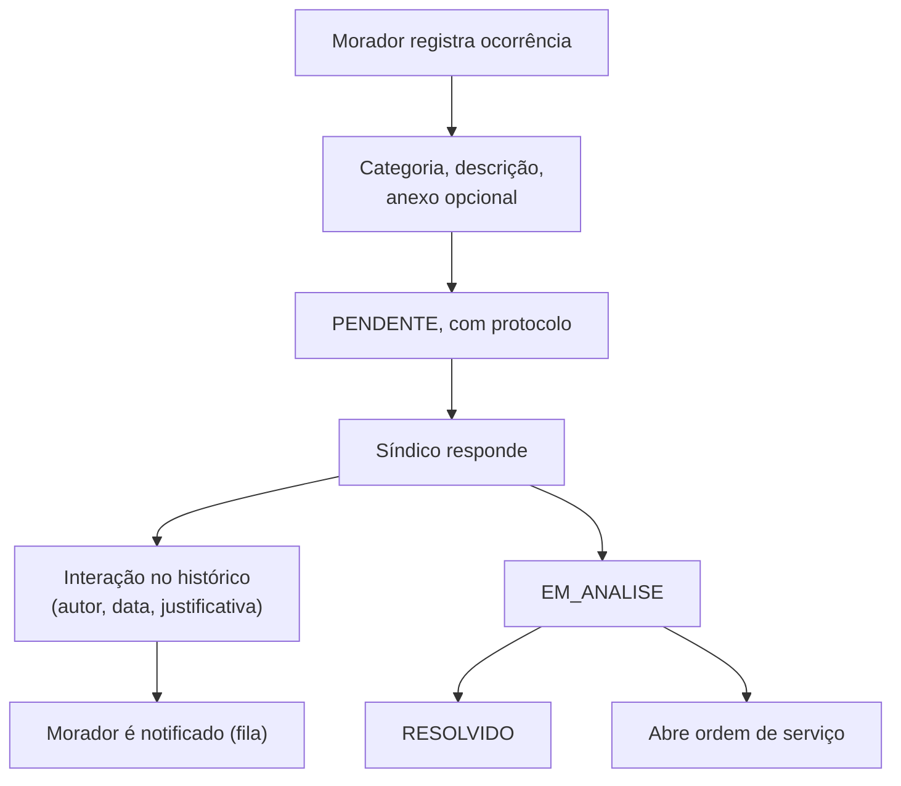
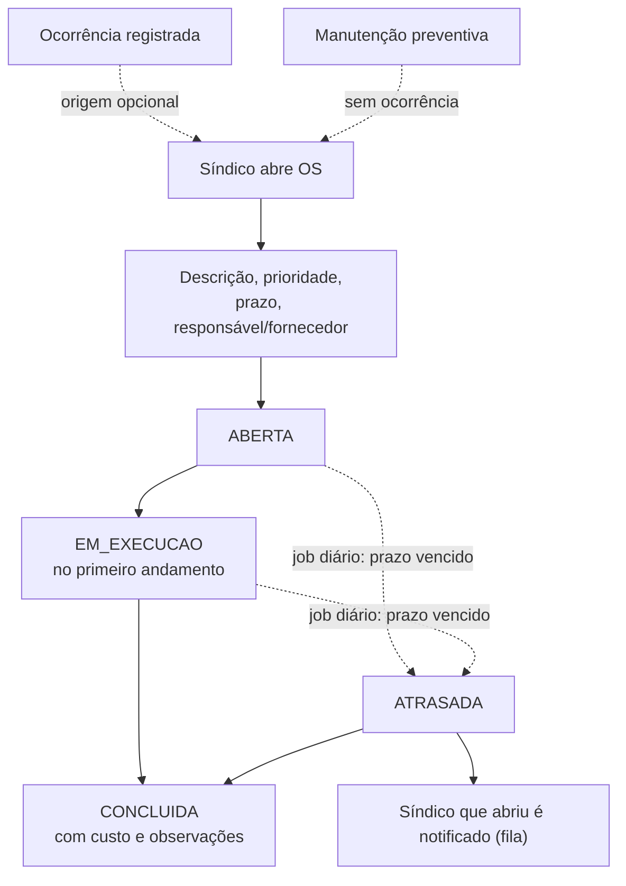

# ocorrencias-service

**Stack:** Java 21 · Spring Boot — **Porta:** 8095 — **Banco:** `mora_ocorrencias`
**Gateway:** `/api/ocorrencias` — **Swagger:** `http://localhost:8095/swagger-ui/index.html`
**Status:** ✅ em operação — as reclamações migraram do `auth-api` para cá (D27)

---

## Responsabilidade

Cobre o ciclo que vai da **queixa do morador até a manutenção executada**: registrar a
ocorrência, atender, e abrir ordem de serviço quando exigir intervenção técnica.

| RF | Requisito |
|---|---|
| 14 | Gerenciar Ocorrências e Ordens de Serviço |

**Escopo do requisito**, conforme a especificação: registro da ocorrência, atendimento, abertura
de ordem de serviço, responsável e prazo. Critérios de aceite em `HISTORIAS-DE-USUARIO.md`
(ocorrências e ordens de serviço).

---

## Quem faz o quê

| Perfil | Pode |
|---|---|
| Morador (e qualquer usuário do condomínio) | Registrar ocorrência; ver as próprias, com histórico e OS vinculadas |
| Síndico (`ADMIN_SINDICO`) | Ver todas as do condomínio; responder e mudar status; abrir, conduzir e concluir OS; cadastrar fornecedores |
| Admin Geral | Acompanhar (ler) qualquer condomínio. Não responde nem abre OS — mesma regra do comunicacao |

Registro de outro condomínio responde **404**, não 403: quem não pode ver não descobre que existe.

---

## Fluxos de usuário

### Ocorrência



- A resposta é obrigatória; com mudança de status, ela é a **justificativa**.
- Abrir uma OS a partir de uma ocorrência `PENDENTE` a passa para `EM_ANALISE`, e a abertura
  entra no histórico da ocorrência.
- A tela mostra o tempo decorrido desde a abertura (ou o tempo até resolver).

### Ordem de serviço



- **Prazo vencido** é prazo antes de hoje; no próprio dia ainda está em dia.
- O job roda às 6h (`OS_ATRASO_CRON`) e também na subida do serviço, para não perder a
  execução se o container estiver parado de madrugada. Rodar de novo não repete nada.
- **No prazo** = concluída até o fim do dia do prazo. Alimenta o indicador de OS no prazo.

---

## Banco de dados

Criado pelo **Flyway** na subida (`src/main/resources/db/migration`, histórico em
`flyway_historico_ocorrencias`); o Hibernate só confere (`ddl-auto: validate`), como nos outros
serviços Java. Ver `docs/MIGRACOES.md`.

| Tabela | Papel |
|---|---|
| `reclamacoes` | Ocorrência: protocolo, categoria, descrição, anexo, status, `resolvido_em` |
| `reclamacao_interacoes` | Histórico de atendimento: autor, mensagem, status anterior e novo |
| `ordens_servico` | OS: descrição, prioridade, prazo, responsável, fornecedor, ocorrência de origem, status, custo, observações |
| `ordem_servico_andamentos` | Histórico da OS, com autor (nulo quando é o sistema) |
| `fornecedores` | Prestadores. Não se excluem: desativam (`ativo = false`) |

Todas com `condominio_id`.

### Decisões sobre o que estava em aberto

| Questão | Decisão |
|---|---|
| Categorias fixas ou configuráveis | **Fixas** (`CategoriaReclamacao`) — as mesmas que a tela já oferecia |
| Fornecedor: cadastro ou texto | **Cadastro**, opcional na OS. Sem fornecedor, o responsável é texto livre |
| SLA por prioridade | Não implementado: o prazo é informado por OS |
| Anexos | Continua uma URL (`anexo_url`), como no auth-api |

---

## API

| Método | Rota | Quem |
|---|---|---|
| `POST` | `/reclamacoes` | Qualquer usuário do condomínio |
| `GET` | `/reclamacoes/minhas` | Quem pede |
| `GET` | `/reclamacoes?status=` | Gestão (Admin Geral: `?condominioId=`) |
| `GET` | `/reclamacoes/{id}` | Dono ou gestão |
| `PATCH` | `/reclamacoes/{id}` — `{ mensagem, status? }` | Síndico |
| `GET` | `/reclamacoes/categorias` | Qualquer |
| `GET` | `/reclamacoes/estatisticas?meses=` | Gestão — painel do síndico |
| `GET` | `/reclamacoes/contagem?condominioIds=` | Gestão — painel do Admin Geral (síndico: o próprio) |
| `POST` | `/ordens-servico` | Síndico |
| `GET` | `/ordens-servico?status=` | Gestão |
| `GET` | `/ordens-servico/{id}` | Gestão |
| `POST` | `/ordens-servico/{id}/andamentos` — `{ mensagem }` | Síndico |
| `POST` | `/ordens-servico/{id}/conclusao` — `{ custo, observacoes }` | Síndico |
| `GET` | `/ordens-servico/estatisticas` | Gestão |
| `GET` `POST` `PUT` | `/fornecedores` | Gestão lê; síndico escreve |

---

## Notificações por fila (RabbitMQ)

O serviço publica na exchange `mora.notificacoes` (tópico), chave `notificacao.ocorrencias`. O
`comunicacao-service` consome pela fila `comunicacao.notificacoes` e grava na caixa de entrada.

| Tipo | Quando | Para quem |
|---|---|---|
| `OCORRENCIA_RESPONDIDA` | Síndico responde | Morador que abriu |
| `ORDEM_SERVICO_ABERTA` | OS aberta a partir da ocorrência | Morador que abriu |
| `ORDEM_SERVICO_ATRASADA` | Job marca a OS como atrasada | Síndico que abriu a OS |

- A mensagem tem o mesmo formato da rota `/interno/notificacoes` do comunicacao, com
  `chaveUnica` — uma entrega repetida não duplica a notificação.
- **Só sai depois do commit**: se a transação desfizer, ninguém é avisado de algo que não foi gravado.
- **Falha macia**: com o broker fora do ar a ocorrência e a OS funcionam; só o aviso deixa de
  sair, com log. O comunicacao aceita os tipos novos a partir da migração Flyway
  `V5__notificacoes_ocorrencias.sql`. O health do Rabbit está desligado nos dois serviços, para o broker parado não
  tirar o serviço do gateway.

> A decisão D10 previa notificação por HTTP, sem broker. Para este serviço a equipe optou pela
> fila; o financeiro continua usando a rota HTTP.

---

## Integrações

| Com | Para quê |
|---|---|
| `auth-api` | Nome e e-mail de quem abriu, na lista da gestão (repassando o Bearer; falha macia) |
| `comunicacao-service` | Entrega das notificações, pela fila |
| `gestao-geral` | Estatísticas e contagens para os painéis; indicadores de OS no painel operacional |

---

## Subir e migrar

Em um volume do Postgres que já existe, o banco novo precisa ser criado à mão:

```bash
docker exec -i postgres psql -U admin -d postgres < docker/criar-banco-ocorrencias.sql
docker compose -f docker/docker-compose.yml up -d --build rabbitmq ocorrencias-service comunicacao-service auth-api gestao-geral
```

As tabelas são criadas pelo Flyway na subida, e o CHECK de tipos de notificação do comunicacao
é ampliado pela migração `V4` dele. Falta só trazer as reclamações antigas do `auth_db` (uma vez,
à mão):

```bash
docker exec -i postgres psql -U admin -d mora_ocorrencias < services/ocorrencias-service/src/main/resources/db/manual/migrar-reclamacoes-auth-db.sql
```

A migração mantém `id` e protocolo, converte o JSON `interactions` em linhas de
`reclamacao_interacoes` e é idempotente. A tabela antiga do `auth_db` **não é apagada** — fica
como cópia até a migração ser conferida.
